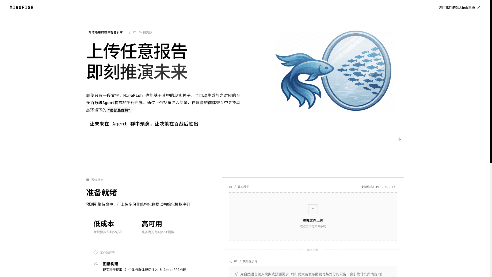
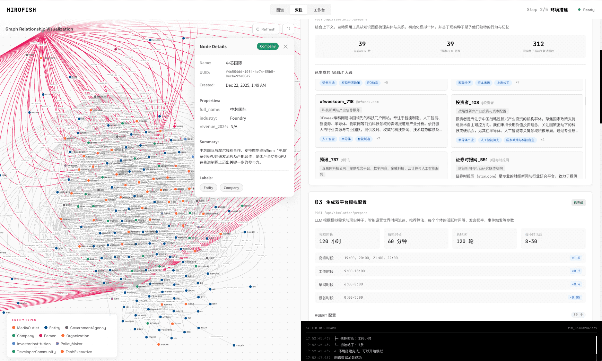
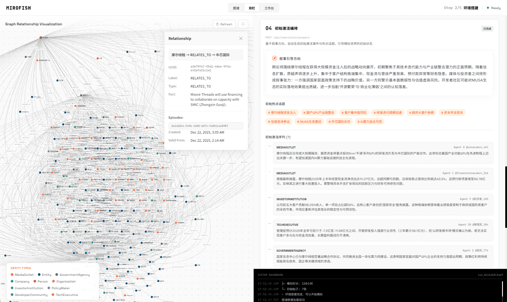
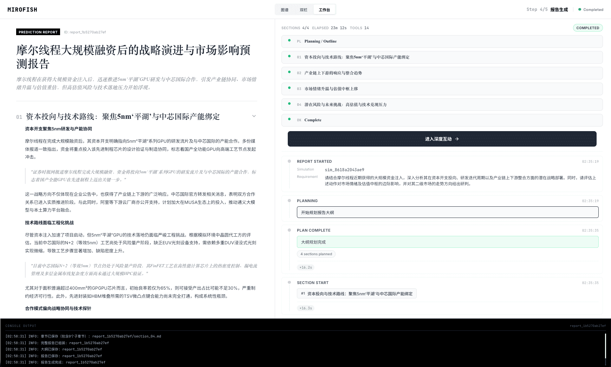
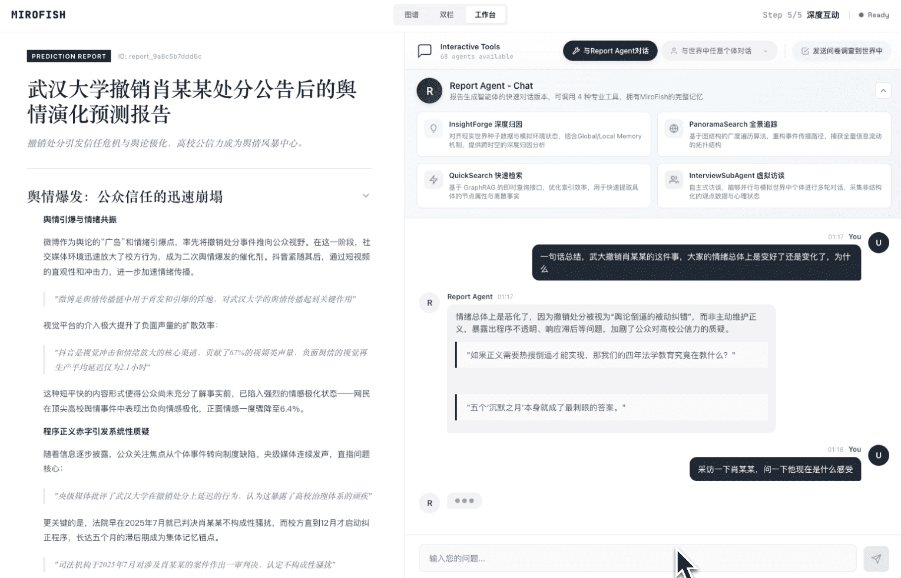
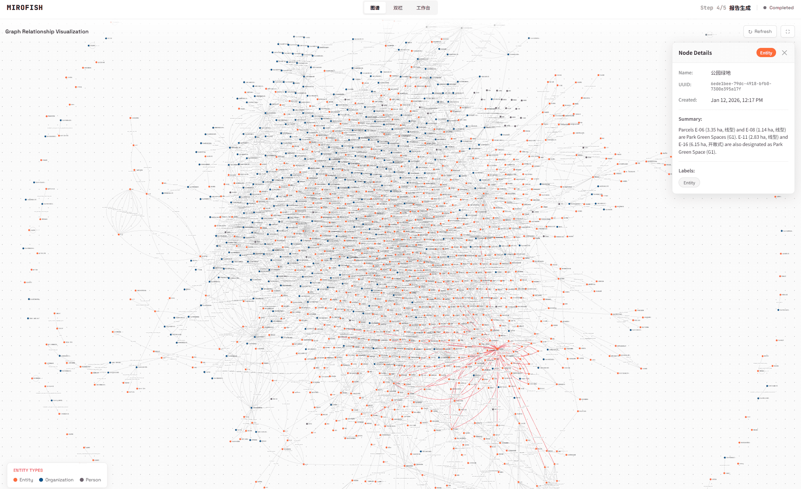
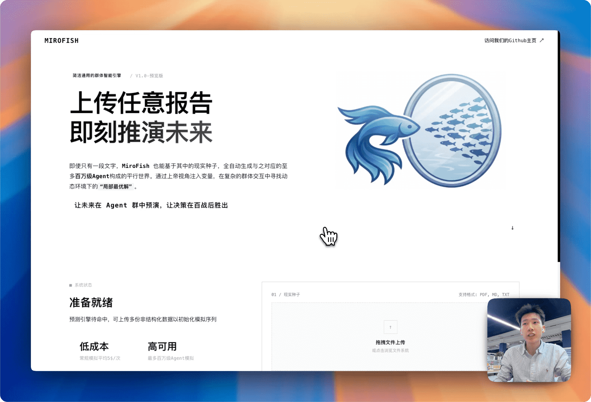
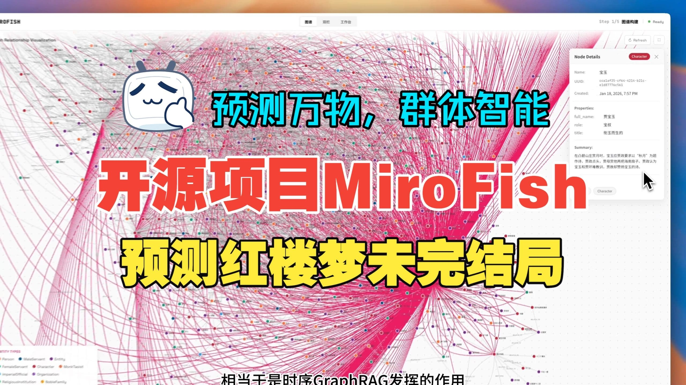
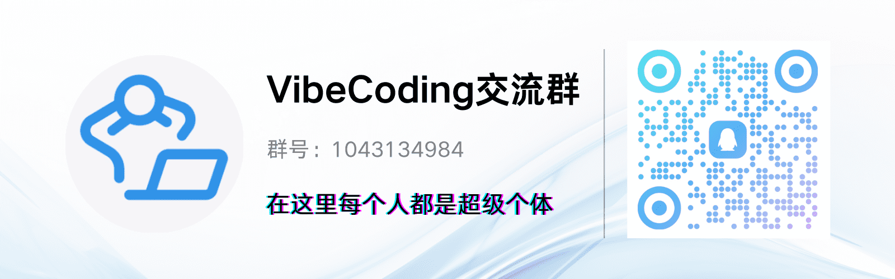

<div align="center">


<a href="https://trendshift.io/repositories/16144" target="_blank"></a>

<em>A Simple and Universal Swarm Intelligence Engine, Predicting Anything</em>

<a href="https://www.shanda.com/" target="_blank"></a>

[](https://github.com/666ghj/MiroFish/stargazers)
[](https://github.com/666ghj/MiroFish/watchers)
[](https://github.com/666ghj/MiroFish/network)
[](https://hub.docker.com/)
[](https://deepwiki.com/666ghj/MiroFish)

[](http://discord.gg/ePf5aPaHnA)
[](https://x.com/mirofish_ai)
[](https://www.instagram.com/mirofish_ai/)

</div>

## ⚡ Overview

**MiroFish** is a next-generation AI prediction engine powered by multi-agent technology. By extracting seed information from the real world (such as breaking news, policy drafts, or financial signals), it automatically constructs a high-fidelity parallel digital world. Within this space, thousands of intelligent agents with independent personalities, long-term memory, and behavioral logic freely interact and undergo social evolution. You can inject variables dynamically from a "God's-eye view" to precisely deduce future trajectories — **rehearse the future in a digital sandbox, and win decisions after countless simulations**.

> You only need to: Upload seed materials (data analysis reports or interesting novel stories) and describe your prediction requirements in natural language</br>
> MiroFish will return: A detailed prediction report and a deeply interactive high-fidelity digital world

### Our Vision

MiroFish is dedicated to creating a swarm intelligence mirror that maps reality. By capturing the collective emergence triggered by individual interactions, we break through the limitations of traditional prediction:

- **At the Macro Level**: We are a rehearsal laboratory for decision-makers, allowing policies and public relations to be tested at zero risk
- **At the Micro Level**: We are a creative sandbox for individual users — whether deducing novel endings or exploring imaginative scenarios, everything can be fun, playful, and accessible

From serious predictions to playful simulations, we let every "what if" see its outcome, making it possible to predict anything.

## 🌐 Live Demo

Welcome to visit our online demo environment and experience a prediction simulation on trending public opinion events we've prepared for you: [mirofish-live-demo](https://666ghj.github.io/mirofish-demo/)

## 📸 Screenshots

<div align="center">
<table>
<tr>
<td></td>
<td></td>
</tr>
<tr>
<td></td>
<td></td>
</tr>
<tr>
<td></td>
<td></td>
</tr>
</table>
</div>

## 🎬 Demo Videos

### 1. Wuhan University Public Opinion Simulation + MiroFish Project Introduction

<div align="center">
<a href="https://www.bilibili.com/video/BV1VYBsBHEMY/" target="_blank"></a>

Click the image to watch the complete demo video for prediction using BettaFish-generated "Wuhan University Public Opinion Report"
</div>

### 2. Dream of the Red Chamber Lost Ending Simulation

<div align="center">
<a href="https://www.bilibili.com/video/BV1cPk3BBExq" target="_blank"></a>

Click the image to watch MiroFish's deep prediction of the lost ending based on hundreds of thousands of words from the first 80 chapters of "Dream of the Red Chamber"
</div>

> **Financial Prediction**, **Political News Prediction** and more examples coming soon...

## 🔄 Workflow

1. **Graph Building**: Seed extraction & Individual/collective memory injection & GraphRAG construction
2. **Environment Setup**: Entity relationship extraction & Persona generation & Agent configuration injection
3. **Simulation**: Dual-platform parallel simulation & Auto-parse prediction requirements & Dynamic temporal memory updates
4. **Report Generation**: ReportAgent with rich toolset for deep interaction with post-simulation environment
5. **Deep Interaction**: Chat with any agent in the simulated world & Interact with ReportAgent

## 🚀 Quick Start

### Option 1: Source Code Deployment (Recommended)

#### Prerequisites

| Tool | Version | Description | Check Installation |
|------|---------|-------------|-------------------|
| **Node.js** | 18+ | Frontend runtime, includes npm | `node -v` |
| **Python** | ≥3.11, ≤3.12 | Backend runtime | `python --version` |
| **uv** | Latest | Python package manager | `uv --version` |

#### 1. Configure Environment Variables

```bash
# Copy the example configuration file
cp .env.example .env

# Edit the .env file and fill in the required API keys
```

**Required Environment Variables:**

```env
# LLM API Configuration (any OpenAI-compatible endpoint)
# Free and open routes (no paid account needed):
#   OpenRouter : https://openrouter.ai/api/v1   openrouter/free
#                free key at https://openrouter.ai/keys, models ending in ":free" cost nothing
#   OmniRoute  : http://127.0.0.1:20128/v1      auto (npm i -g omniroute; key optional by default)
#   Ollama     : http://127.0.0.1:11434/v1      llama3.1   (local, no key needed)
#   Groq       : https://api.groq.com/openai/v1 llama-3.3-70b-versatile
#   Gemini     : https://generativelanguage.googleapis.com/v1beta/openai  gemini-2.5-flash
# Paid routes: Alibaba Bailian (https://bailian.console.aliyun.com/), OpenAI, DeepSeek
# High consumption, try simulations with fewer than 40 rounds first
LLM_API_KEY=your_api_key
LLM_BASE_URL=https://openrouter.ai/api/v1
LLM_MODEL_NAME=openrouter/free

# Zep Cloud Configuration
# Free monthly quota is sufficient for simple usage: https://app.getzep.com/
ZEP_API_KEY=your_zep_api_key
```

Local providers (Ollama, llama.cpp, LM Studio, OmniRoute) need no API key at all: leave
`LLM_API_KEY` empty and point `LLM_BASE_URL` at the local port, and MiroFish fills in a
placeholder internally.

#### 2. Install Dependencies

```bash
# One-click installation of all dependencies (root + frontend + backend)
npm run setup:all
```

Or install step by step:

```bash
# Install Node dependencies (root + frontend)
npm run setup

# Install Python dependencies (backend, auto-creates virtual environment)
npm run setup:backend
```

#### 3. Start Services

```bash
# Start both frontend and backend (run from project root)
npm run dev
```

**Service URLs:**
- Frontend: `http://localhost:3000`
- Backend API: `http://localhost:5001`

**Start Individually:**

```bash
npm run backend   # Start backend only
npm run frontend  # Start frontend only
```

### Option 2: Docker Deployment

```bash
# 1. Configure environment variables (same as source deployment)
cp .env.example .env

# 2. Pull image and start
docker compose up -d
```

Reads `.env` from root directory by default, maps ports `3000 (frontend) / 5001 (backend)`

> Mirror address for faster pulling is provided as comments in `docker-compose.yml`, replace if needed.

### Option 3: Windows 10/11 Desktop Installer

If you'd rather not set up Python and Node.js, run the installer:

1. Download `MiroFish-<version>-windows-x64-setup.exe` from
   [Releases](https://github.com/cfunkycreations-tech/MiroFish/releases).
2. Double-click it. The installer needs **no administrator rights**: it installs into
   `%LOCALAPPDATA%\Programs\MiroFish`, adds a Start Menu entry (plus a desktop shortcut and an
   uninstaller) and shows up in *Settings > Apps > Installed apps*.
   `/S` installs silently; `/D=<path>` picks another folder.
3. Start **MiroFish** from the Start Menu. The first launch downloads the Python runtime
   (about 1.1 GB, roughly 400 MB with the slim setup), after which the app runs offline.
4. The app opens the **Configure MiroFish** page on the first run: choose a free route such as
   OpenRouter, OmniRoute or Ollama, paste the key, hit *Test connection* and *Save*.

The portable ZIPs (`MiroFish-*-windows-x64-setup.zip` / `-offline.zip`) still work the same way:
extract anywhere you can write and double-click `MiroFish.exe`.

> Build the installer: `python desktop/build.py --mode setup --out dist` then
> `python desktop/build_installer.py --no-build` (needs NSIS 3; `desktop/installer.nsi` holds the script).

Portable build details:

1. Extract the ZIP anywhere you have write access.
2. Double-click `MiroFish.exe`:
   * offline build: the native window opens straight away;
   * setup build: the first launch offers to download the runtime (about 500 MB–1 GB), after which it works offline.
3. On first launch the app opens the **Configure MiroFish** page — paste your LLM and Zep
   API keys, hit *Test connection*, then *Save*, and you can start predicting.

Desktop highlights:

| Feature | Details |
|---------|---------|
| Native window | WebView2 (ships with Windows 10/11), no browser needed |
| In-app setup | API keys stored in `%APPDATA%\MiroFish\.env`; survives upgrades |
| Local only | Backend binds `127.0.0.1` on a random free port, never exposed |
| Troubleshooting | `MiroFish-Console.bat` keeps the console/logs; `--browser` falls back to a browser |
| Update hint | Checks GitHub Releases on startup, silently skipped when offline |

> Build it yourself: `python desktop/fetch_sources.py` to fetch the Windows wheels and
> embeddable Python, then `python desktop/build.py --mode offline` (or `--mode setup`).
> Pushing a `v*` tag triggers the `desktop-build` GitHub Actions workflow on `windows-latest`,
> which uploads the release assets.

#### Running it for free

MiroFish talks to any OpenAI-compatible endpoint, so a paid LLM account is optional. All of these
are one click away in the app's settings page:

| Route | Base URL | Model | Cost |
|-------|----------|-------|------|
| **OpenRouter** | `https://openrouter.ai/api/v1` | `openrouter/free` (or any `:free` model) | free key from [openrouter.ai/keys](https://openrouter.ai/keys) |
| **OmniRoute** | `http://127.0.0.1:20128/v1` | `auto` | free, self-hosted: `npm install -g omniroute` then `omniroute` |
| **Ollama** | `http://127.0.0.1:11434/v1` | `llama3.1` (or any pulled model) | free, fully local, no key |
| **Groq** | `https://api.groq.com/openai/v1` | `llama-3.3-70b-versatile` | free tier |
| **Google AI Studio** | `https://generativelanguage.googleapis.com/v1beta/openai` | `gemini-2.5-flash` | free tier |

Local routes (OmniRoute, Ollama, LM Studio, llama.cpp) need no API key at all — leave
`LLM_API_KEY` empty and MiroFish fills in a placeholder internally. The knowledge-graph memory
still needs the free **Zep Cloud** key ([app.getzep.com](https://app.getzep.com/)); it is what
stores the graph the simulation reads from.

## 📬 Join the Conversation

<div align="center">

</div>

&nbsp;

The MiroFish team is recruiting full-time/internship positions. If you're interested in multi-agent simulation and LLM applications, feel free to send your resume to: **mirofish@shanda.com**

## 📄 Acknowledgments

**MiroFish has received strategic support and incubation from Shanda Group!**

MiroFish's simulation engine is powered by **[OASIS (Open Agent Social Interaction Simulations)](https://github.com/camel-ai/oasis)**, We sincerely thank the CAMEL-AI team for their open-source contributions!

## 📈 Project Statistics

<a href="https://www.star-history.com/#666ghj/MiroFish&type=date&legend=top-left">
 <picture>
   <source media="(prefers-color-scheme: dark)" srcset="https://api.star-history.com/svg?repos=666ghj/MiroFish&type=date&theme=dark&legend=top-left" />
   <source media="(prefers-color-scheme: light)" srcset="https://api.star-history.com/svg?repos=666ghj/MiroFish&type=date&legend=top-left" />
   
 </picture>
</a>
